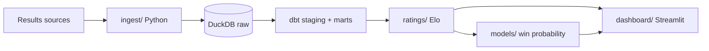

# 🤼 Wrestling Data Pipeline

An end-to-end data pipeline, rating system, and win probability model for NCAA Division I wrestling, built by a D1 wrestler.

**Question this project answers:** Can a data-driven rating system rank wrestlers as well as (or better than) the official rankings, and how well can we predict who wins a match?


<!-- Add a screenshot or GIF of the dashboard here once Phase 5 is done -->

## Key findings
<!-- Fill these in as you go. One or two sentences each, with a number. -->
- _Coming soon_

Full writeup: [reports/findings.md](reports/findings.md)

## How it works



| Phase | What | Where | Status |
|---|---|---|---|
| 1 | Collect NCAA D1 results into DuckDB | `ingest/` | ⬜ |
| 2 | Clean and model: wrestlers, matches, results, weight classes | `dbt/` | ⬜ |
| 3 | Elo ratings + comparison to official rankings | `ratings/` | ⬜ |
| 4 | Win probability model, evaluated on a held-out season | `models/` | ⬜ |
| 5 | Dashboard + writeup | `dashboard/`, `reports/` | ⬜ |

## Tech stack
Python, DuckDB, dbt, pandas, scikit-learn, Streamlit, pytest, GitHub Actions

## Run it yourself

The repo ships with a small **synthetic** dataset so everything runs without collecting real data.

```bash
git clone https://github.com/andersonowenk-bit/wrestling-data-pipeline.git
cd wrestling-data-pipeline
python -m venv .venv && source .venv/bin/activate
make setup        # install packages
make all          # ingest, dbt, Elo, model
make dashboard    # open the dashboard
make test         # run tests
```

To use real data, drop CSVs into `data/raw/` (format in [data/README.md](data/README.md)) and run `make all` again.

## Project structure

```
ingest/       Phase 1: load and collect results
dbt/          Phase 2: SQL models that clean and shape the data
ratings/      Phase 3: Elo system and ranking comparison
models/       Phase 4: features, training, evaluation
dashboard/    Phase 5: Streamlit app
reports/      Findings, metrics, figures
tests/        Unit tests
notebooks/    Exploration
scripts/      Helpers (synthetic data generator)
```

## Limitations
- Wrestlers are matched by name, with an alias table for spelling variations. Two wrestlers with the same name would be merged.
- Forfeits are kept in the data but excluded from ratings.
- _Add more as you find them. Being honest here is a strength._

## About me
Owen Anderson, Business Analytics and Applied AI at Sacred Heart University, D1 wrestler.
[LinkedIn](https://www.linkedin.com/in/owen-anderson-7a28283a8)
